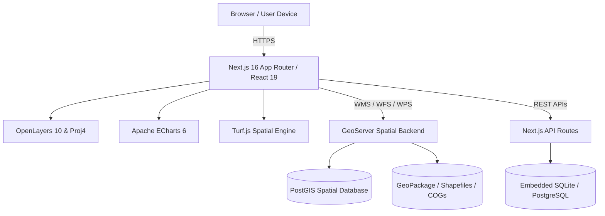

<div align="center">


# VistaBridge

### Enterprise Spatial Data Infrastructure (SDI) & Web GIS Platform

*Empowering organizations to visualize, query, analyze, and build executive dashboards on top of any GeoServer instance.*

[](https://rottengrapes.tech/)
[](https://vistabridge.rottengrapes.tech/)
[](https://rottengrapes.tech/docs/vistabridge/)

[](https://nextjs.org/)
[](https://react.dev/)
[](https://www.typescriptlang.org/)
[](https://openlayers.org/)
[](https://echarts.apache.org/)
[](https://ant.design/)

---

[Instant Trial](#instant-live-trial) •
[Documentation](#documentation--resources) •
[Key Features](#key-features) •
[Architecture](#architecture--tech-stack) •
[Quick Start](#quick-start-guide) •
[Docker Deployment & Updates](#docker-deployment--instant-updates) •
[About Rotten Grapes](#about-rotten-grapes-private-limited)

---

</div>

## Instant Live Trial

You can explore VistaBridge directly in your browser with our hosted cloud demo environment:

| Resource | URL / Details |
| :--- | :--- |
| **Live Application** | [https://vistabridge.rottengrapes.tech/](https://vistabridge.rottengrapes.tech/) |
| **Demo Username** | `geouser` |
| **Demo Password** | `geouser` |
| **Official Documentation** | [https://rottengrapes.tech/docs/vistabridge/](https://rottengrapes.tech/docs/vistabridge/) |

> **Tip:** Log in with the credentials above to test live 2D mapping, spatial layer filtering, dynamic query building, and executive dashboard composition with pre-loaded spatial layers.

---

## What is VistaBridge?

**VistaBridge** is a modern, production-grade Web GIS and Spatial Data Infrastructure (SDI) solution engineered by **[Rotten Grapes Private Limited](https://rottengrapes.tech/)**. 

Traditional GIS software often suffers from complex desktop setups, clunky user interfaces, and siloed data workflows. VistaBridge bridges this gap by connecting directly to your existing **GeoServer** infrastructure to provide a lightning-fast, web-based control plane for:
- Interactive map exploration and spatial data visualization
- Advanced visual CQL / ECQL attribute & spatial query building
- Drag-and-drop executive dashboards combining maps, interactive charts, and KPIs
- Production-ready PDF report generation
- Complete white-labeling and multi-tenant customization

---

## Key Features

### 1. High-Performance 2D Web Mapping
- **OpenLayers 10 Engine**: Hardware-accelerated rendering with full support for vector, raster, and tile layers.
- **Dynamic OGC Services**: Native support for **WMS**, **WFS**, and **WPS** with dynamic layer catalog discovery.
- **Layer & Styling Controls**: Granular control over layer order, opacity, visibility, and on-the-fly thematic styling.
- **Interactive Measurement & Drawing**: Tools for distance, area calculation, point coordinates, and polygon boundary drawing.

### 2. Advanced Spatial Query & Visual CQL Builder
- **Visual Expression Builder**: Build complex filtering conditions without writing raw SQL or CQL syntax by hand.
- **Attribute Queries**: Filter datasets using logical operators (`=`, `!=`, `>`, `<`, `LIKE`, `IN`, `BETWEEN`).
- **Spatial Operators**: Perform spatial interactions including **INTERSECTS**, **WITHIN**, **CONTAINS**, and **DISJOINT**.
- **Cross-Layer & Buffer Queries**: Query features in a target layer based on spatial relationships or buffers around reference layers.
- **Smart Fallback Engine**: Seamlessly falls back from GeoServer WFS POST spatial filters to client-side **Turf.js** processing to eliminate feature-limit bottlenecks.

### 3. Drag-and-Drop Executive Dashboard Studio
- **Freeform Grid Layout**: Powered by `react-grid-layout` with responsive resizable and draggable widgets.
- **Rich Widget Library**:
  - **Live Map Widgets**: Interactive OpenLayers instances linked to filtered dataset views.
  - **Apache ECharts Visualizations**: Bar, Line, Pie, Donut, Scatter, and GeoCharts automatically synchronized with spatial attributes.
  - **KPI & Stat Cards**: Key metrics, counters, and progress indicators.
  - **Rich Text Notes & Documentation**: WYSIWYG note cards for context and annotations.
- **Spatial Extent Synchronization**: Pan or zoom a map widget to dynamically update linked statistical charts.


### 4. Multi-Page PDF & Report Export
- **Print Layout Sandbox**: Rearrange widgets across designated paper sheets before export.
- **Standard Page Formats**: Full support for **A4**, **A3**, and **Letter** paper sizes.
- **Flexible Orientation**: Switch between **Landscape** and **Portrait** modes.
- **Ultra-HD Quality**: High-resolution canvas rasterization via `html2canvas-pro` and vector generation via `jspdf`.
- **Automated Pagination & Branding**: Configurable headers, footers, pagination (`Page X of Y`), timestamps, and custom logos.

### 5. White-Labeling & Brand Customization
- Tailor the entire platform to your corporate identity in real time:
  - Custom branding colors (Primary & Secondary palettes)
  - Custom brand logo and favicon
  - Application title, subtitle, and footer credits
  - Automatic persistence via local SQLite database or PostgreSQL

### 6. Frictionless Setup & Platform Portability
- **One-Click Launchers**: Automated setup and launch scripts for both Windows (`setup.bat`, `start.bat`) and Linux/macOS (`setup.sh`, `start.sh`).
- **Embedded Database**: Zero-config SQLite database (`@libsql/client`) for local storage, with seamless PostgreSQL migration options for enterprise scale.
- **Port Conflict Management**: Automatically detects occupied ports and offers quick remapping or termination.

---

## Architecture & Tech Stack



### Core Technologies

| Component | Technology | Version | Purpose |
| :--- | :--- | :--- | :--- |
| **Framework** | [Next.js](https://nextjs.org/) | `16.2.6` | App Router, SSR, and API endpoints |
| **UI Library** | [React](https://react.dev/) | `19.2.4` | Modern component rendering |
| **Language** | [TypeScript](https://www.typescriptlang.org/) | `5.x` | Strict type safety across the entire application |
| **GIS Mapping** | [OpenLayers](https://openlayers.org/) | `10.9.0` | 2D Web map visualization & layer orchestration |
| **Spatial Analysis** | [Turf.js](https://turfjs.org/) | `7.3.5` | Spatial predicates, buffers, and geometric computations |
| **Charts & Data** | [Apache ECharts](https://echarts.apache.org/) | `6.1.0` | High-performance interactive visualizations |
| **Component Design**| [Ant Design](https://ant.design/) | `6.4.2` | Clean, accessible enterprise UI widgets |
| **Styling** | [Tailwind CSS](https://tailwindcss.com/) | `4.x` | Modern utility-first responsive styling |
| **Grid Management** | [react-grid-layout](https://github.com/react-grid-layout/react-grid-layout) | `2.2.3` | Responsive draggable/resizable dashboard canvas |
| **State Management**| [Zustand](https://zustand-demo.pmnd.rs/) | `5.0.13` | Lightweight, unopinionated reactive stores |
| **Local Storage** | [libSQL / SQLite](https://github.com/tursodatabase/libsql-client-ts) | `0.18.0` | Embedded persistence for workspaces & settings |

---

## Quick Start Guide

### Prerequisites
- **Node.js**: Latest LTS (`v20.x` or `v22.x`+) ([Download Node.js](https://nodejs.org/))
- **GeoServer**: Any accessible GeoServer instance (v2.20.x – v2.26.x+ or higher, local or remote URL — e.g., `http://localhost:8080/geoserver` or your domain)
- **Port & Configuration**: Runs on port `3000` by default or any port you specify. All configurations and environment parameters are stored directly in the embedded database (`data/geovista.db`) created during setup — no `.env` file management required.
- **Git**: Installed and available in your system path

---

### Option A: Automated Setup Scripts

#### On Windows:
Double-click or run:
```cmd
setup.bat
```
Follow the interactive prompts to configure your GeoServer URL and preferred port, then launch anytime with:
```cmd
start.bat
```

#### On Linux / macOS:
Make the scripts executable and run:
```bash
chmod +x setup.sh start.sh stop.sh
./setup.sh
./start.sh
```

---

### Option B: Manual Setup

#### 1. Clone the repository
```bash
git clone https://github.com/rottengrapes/VistaBridge.git
cd VistaBridge
```

#### 2. Install dependencies
```bash
npm install
```

#### 3. Initialize Configuration Database
VistaBridge manages application settings and environment variables directly inside an embedded SQLite database (`data/geovista.db` in the `app_settings` table). Run the setup script (`setup.bat` / `setup.sh`) or initialize the settings table:
```bash
# Automated configuration prompt:
./setup.sh    # or setup.bat on Windows
```

#### 4. Run the development server
```bash
npm run dev
```

Open [http://localhost:3000](http://localhost:3000) (or your configured port) in your browser.

#### 5. Build for production
```bash
npm run build
npm run start
```

---

<a id="docker-deployment--instant-updates" name="docker-deployment--instant-updates"></a>
## Docker Deployment & Instant Updates

Deploy VistaBridge using our official pre-compiled production Docker image:  
**`rottengrapesprivatelimited/vistabridge:latest`**

This method requires **zero Node.js or build dependencies** and provides an integrated **Nginx reverse proxy** for automatic Port 80 and Domain/IP routing.

---

#### 📋 Quick Start: Direct Copy-Paste Deployment (Zero Cloning Needed)

Any user or server administrator can deploy VistaBridge by creating just **two files** (`.env` and `docker-compose.yml`) in an empty folder:

##### 1. Create `.env`
Create a file named `.env` and paste:
```env
# ==============================================================================
# VistaBridge Environment Configuration
# ==============================================================================

# Application & Network Settings
PORT=3007
HOSTNAME=0.0.0.0
NODE_ENV=production
NEXT_TELEMETRY_DISABLED=1

# Nginx Reverse Proxy Settings (Accessible via port 80 without typing :3007)
HTTP_PORT=80
# Set your domain (e.g. vistabridge.example.com) or use '_' to allow access via Server IP
DOMAIN=_

# Official Docker Hub Image
DOCKER_IMAGE=rottengrapesprivatelimited/vistabridge:latest

# Database Configuration (SQLite)
DB_TYPE=sqlite
SQLITE_DB_PATH=./data/geovista.db

# GeoServer Integration Settings:
# - If your GeoServer runs on the host machine: http://host.docker.internal:8080/geoserver
# - If your GeoServer runs on a remote IP/domain: https://geoserver.example.com/geoserver
# (Note: Only GEOSERVER_URL is required; frontend client endpoints inherit this automatically)
GEOSERVER_URL=http://host.docker.internal:8080/geoserver

# Vector Tile Server (pg_tileserv) Settings
NEXT_PUBLIC_TILESERV_URL=http://host.docker.internal:7800

# Analytics Service URL
NEXT_PUBLIC_ANALYTICS_URL=http://host.docker.internal:8000

# Next.js Internal API Base Route
NEXT_PUBLIC_API_URL=/api

# Authentication Secret (Used for signing login session tokens across container updates)
JWT_SECRET=g4SwHtTa5sXzq8xDpfDik69DGOX9z6ahr6O2IPcwCcIWclnl8uVNE3ePLM5NVJ2i/G785wEDvdmZN9ZqWhQDOw==
```

##### 2. Create `docker-compose.yml`
Create a file named `docker-compose.yml` in the same directory and paste:
```yaml
# ==============================================================================
# VistaBridge Standalone Docker Compose Configuration
# Automatically pulls and launches the latest official image from Docker Hub
# ==============================================================================

services:
  vistabridge:
    platform: linux/amd64
    image: ${DOCKER_IMAGE:-rottengrapesprivatelimited/vistabridge:latest}
    container_name: vistabridge
    pull_policy: always
    restart: unless-stopped
    ports:
      - "${PORT:-3007}:3007"
    environment:
      - NODE_ENV=${NODE_ENV:-production}
      - NEXT_TELEMETRY_DISABLED=${NEXT_TELEMETRY_DISABLED:-1}
      - PORT=${PORT:-3007}
      - HOSTNAME=${HOSTNAME:-0.0.0.0}
      - DB_TYPE=${DB_TYPE:-sqlite}
      - SQLITE_DB_PATH=${SQLITE_DB_PATH:-/app/data/geovista.db}
      - GEOSERVER_URL=${GEOSERVER_URL:-http://host.docker.internal:8080/geoserver}
      - NEXT_PUBLIC_GEOSERVER_URL=${NEXT_PUBLIC_GEOSERVER_URL:-${GEOSERVER_URL:-http://host.docker.internal:8080/geoserver}}
      - NEXT_PUBLIC_TILESERV_URL=${NEXT_PUBLIC_TILESERV_URL:-http://host.docker.internal:7800}
      - NEXT_PUBLIC_API_URL=${NEXT_PUBLIC_API_URL:-/api}
      - NEXT_PUBLIC_ANALYTICS_URL=${NEXT_PUBLIC_ANALYTICS_URL:-http://host.docker.internal:8000}
      - JWT_SECRET=${JWT_SECRET:-}
    volumes:
      # Persistent SQLite database storage on host machine
      - ./data:/app/data
    extra_hosts:
      # Allows container to reach host-level services (e.g. local GeoServer / TileServ)
      - "host.docker.internal:host-gateway"
    healthcheck:
      test: ["CMD-SHELL", "curl -f http://127.0.0.1:${PORT:-3007}/api/config/public || exit 1"]
      interval: 30s
      timeout: 10s
      retries: 3
      start_period: 40s
```

##### 3. Spin Up the Service
Run in your terminal:
```bash
docker compose up -d
```
> **Access URL**: Open [http://localhost:3007](http://localhost:3007) or `http://<SERVER_IP>:3007` in your browser.

---

#### 🚀 For Cloned Repositories (With Nginx Included)

If you have cloned the VistaBridge repository, you can launch VistaBridge with the integrated **Nginx Reverse Proxy** for direct **Port 80** access without entering `:3007`:

```bash
# 1. Copy environment template
cp env.example .env

# 2. Launch with Docker Compose (VistaBridge + Nginx on Port 80)
docker compose up -d
```

> **One-Click Automation**:
> - **On Windows**: Double-click [`docker-update.bat`](docker-update.bat)
> - **On Linux / macOS**: Run `./docker-update.sh`

#### Where to Access:
- **Standard HTTP (Port 80 via Nginx)**: [http://localhost](http://localhost) or `http://<YOUR_SERVER_IP>`
- **Direct Application Port**: [http://localhost:3007](http://localhost:3007)

---

### Running via Pure Docker CLI (Zero Cloning Required)

Anyone can spin up the application on any server without downloading the codebase:

```bash
docker run -d \
  --platform linux/amd64 \
  --name vistabridge \
  --restart unless-stopped \
  -p 3007:3007 \
  -v "${PWD}/data:/app/data" \
  -e PORT=3007 \
  -e HOSTNAME=0.0.0.0 \
  -e GEOSERVER_URL="http://host.docker.internal:8080/geoserver" \
  -e NEXT_PUBLIC_GEOSERVER_URL="http://host.docker.internal:8080/geoserver" \
  rottengrapesprivatelimited/vistabridge:latest
```

---

### How to Apply New Code Changes (Guaranteed Latest Updates)

Whenever new code is pushed to GitHub, a fresh Docker image is automatically built and published to `rottengrapesprivatelimited/vistabridge:latest`.

To guarantee that your running deployment **always downloads and switches to the newest code** without using stale local caches:

```bash
docker compose pull && docker compose up -d --force-recreate
```

#### Why this ensures you always access the newest code:
1. **`docker compose pull`**: Connects to Docker Hub, compares the image digest, and downloads the newly published layers for `rottengrapesprivatelimited/vistabridge:latest`.
2. **`--force-recreate`**: Shuts down the previous container and launches a brand new one using the updated image layers.
3. **Zero Data Loss**: Your SQLite database (`./data/geovista.db`), user accounts, maps, and dashboards are mounted externally and remain 100% preserved.
4. **Browser Hard Refresh**: Since modern browsers cache static Next.js scripts and styles, press **`Ctrl + F5`** (Windows/Linux) or **`Cmd + Shift + R`** (Mac) after updating to immediately load the new frontend assets.

---

## Connecting Your Own GeoServer

VistaBridge connects to any standard GeoServer instance:

1. **Configure GeoServer URL & Port**:
   Set during the interactive setup wizard (`setup.bat` / `setup.sh`) or update the `geoserver_url` and `app_port` entries directly in the `app_settings` table of `data/geovista.db`.
2. **Ensure CORS is enabled on GeoServer**:
   - **For Jetty (Standalone GeoServer)**:
     Uncomment the `CrossOriginFilter` block inside `webapps/geoserver/WEB-INF/web.xml`.
   - **For Apache Tomcat**:
     Enable Tomcat's built-in `CorsFilter` inside Tomcat's `conf/web.xml`.
3. **Verify WFS / WMS services**:
   Ensure `WFS 1.1.0` or `WFS 2.0.0` output format `application/json` is allowed for feature queries.
4. For detailed step-by-step instructions, see our [Setup & Integration Guide](SETUP_GUIDE.md).

---

## Repository Structure

```text
VistaBridge/
├── public/                 # Static assets, logos, and icons
├── src/
│   ├── app/                # Next.js App Router
│   │   ├── api/            # Serverless API routes (GeoServer proxy, auth, settings)
│   │   ├── accounts/       # User profile, appearance & theme settings
│   │   ├── dashboard/      # Executive Dashboard Builder & Viewer
│   │   │   ├── manage/     # Dashboard manager & list
│   │   │   ├── new/        # Dashboard creation wizard
│   │   └── view/           # Interactive canvas & PDF export studio
│   │   ├── map/            # Web GIS Map Workspaces
│   │   │   ├── 2d/         # 2D OpenLayers map viewer & layer manager
│   │   │   ├── manage/     # Saved maps list
│   │   │   └── new/        # Map creation wizard
│   │   └── login/          # Authentication view
│   ├── components/         # Modular React UI components
│   │   ├── dashboard/      # Chart theme pickers, widget wrappers
│   │   │   └── widgets/    # MapWidget, GeoChartWidget, TextWidget
│   │   └── map/            # QueryBuilder, Geocoder, StyleEditor, LayerTree
│   ├── config/             # Site configuration and default brand metadata
│   ├── lib/                # Database clients, GeoServer API proxy, spatial utils
│   └── store/              # Zustand global state stores (Auth, Map, Dashboard)
├── data/                   # Embedded SQLite persistent storage
├── setup.bat / setup.sh    # Interactive setup automation scripts
├── start.bat / start.sh    # Production launchers with port checking
└── stop.bat / stop.sh      # Service termination scripts
```

---

## Documentation & Resources

- **Comprehensive Documentation**: [https://rottengrapes.tech/docs/vistabridge/](https://rottengrapes.tech/docs/vistabridge/)
- **Live Demo & Sandbox**: [https://vistabridge.rottengrapes.tech/](https://vistabridge.rottengrapes.tech/)
- **Frontend Onboarding Guide**: [src/docs/FRONTEND_ONBOARDING.md](src/docs/FRONTEND_ONBOARDING.md)
- **GeoServer Setup Guide**: [SETUP_GUIDE.md](SETUP_GUIDE.md)

---

## About Rotten Grapes Private Limited

**[Rotten Grapes Private Limited](https://rottengrapes.tech/)** is a specialized geospatial technology and software engineering company. We build modern, scalable, and intelligent spatial data infrastructures, remote sensing pipelines, and enterprise GIS applications.

- **Website**: [https://rottengrapes.tech](https://rottengrapes.tech/)
- **Inquiries & Support**: [office@rottengrapes.tech](mailto:office@rottengrapes.tech)
- **Enterprise Consulting**: Custom GIS architectures, GeoServer optimization, spatial database modeling, and dedicated deployments.

---

## License

This software is developed and maintained by **Rotten Grapes Private Limited**.  
For licensing details, commercial support, or custom enterprise solutions, please visit [rottengrapes.tech](https://rottengrapes.tech/) or reach out to [office@rottengrapes.tech](mailto:office@rottengrapes.tech).

<div align="center">
<sub>Crafted with precision by the geospatial engineering team at <strong>Rotten Grapes Private Limited</strong>.</sub>
</div>
